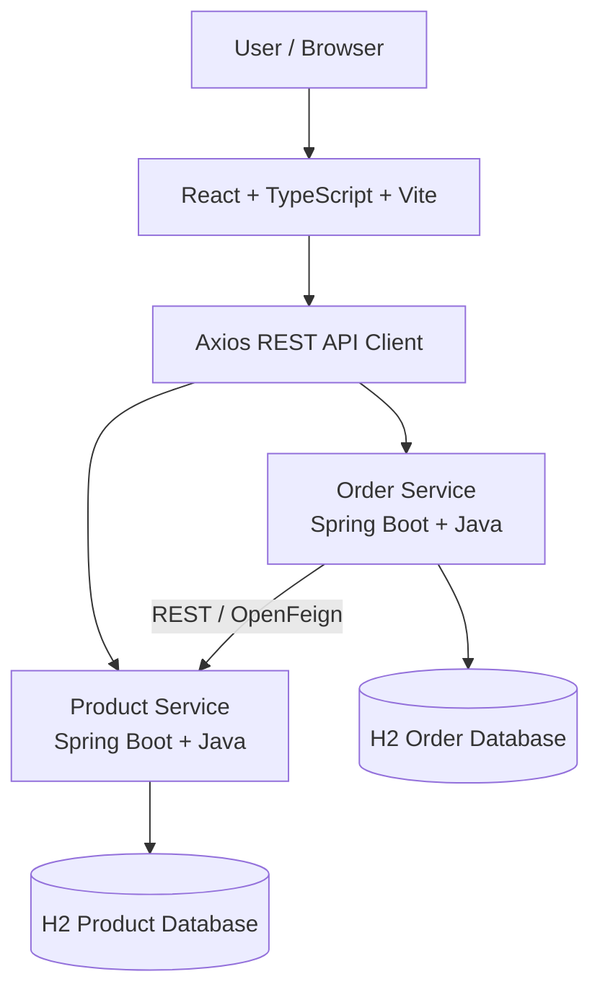

# Java Full-Stack Microservices Lab

A hands-on full-stack application built with Java, Spring Boot, React, TypeScript, and Gradle to practise microservices architecture, REST API development, automated testing, and AI-assisted software engineering with GitHub Copilot.

This project is designed as a practical learning lab for building, testing, debugging, and extending a real-world-style application.

## Project Overview

The application is an **Inventory and Order Management System** with two independent backend microservices and a React frontend.

Users can manage products, browse inventory, create orders, and track order status through a web interface.

The project is being developed incrementally, with a focus on clean code, maintainability, testability, and understanding the design decisions behind each feature.

## Technology Stack

| Area | Technologies |
|---|---|
| Language | Java 21 |
| Backend | Spring Boot, Spring Web |
| Architecture | REST APIs, Microservices |
| Build | Gradle Kotlin DSL |
| Persistence | Spring Data JPA, Hibernate |
| Database | H2 Database |
| Database migrations | Flyway |
| Frontend | React, TypeScript, Vite |
| HTTP client | Axios |
| Testing | JUnit 5, Mockito, Spring Boot Test |
| Code coverage | JaCoCo |
| Monitoring | Spring Boot Actuator |
| Version control | Git, GitHub |
| CI/CD | GitHub Actions |
| AI-assisted development | GitHub Copilot |

*The technology list represents the planned stack. Features will be marked complete as they are implemented and verified.*

## Architecture



### Architectural principles

- **Separation of concerns:** Controllers handle HTTP requests, services contain business logic, and repositories manage persistence.
- **Independent services:** Product and Order services own their respective data.
- **API-based communication:** The Order Service calls the Product Service when product information or availability needs verification.
- **DTO-based APIs:** Request and response objects are separated from database entities.
- **Testability:** Business logic is designed to be tested independently from web and database layers.
- **Local-first development:** H2 allows the initial application to run without a separate database server.

## Features

### Product Service
- Create, view, update, and delete products where business rules permit.
- Search and filter products.
- Validate requests and enforce unique product SKUs.
- Support pagination.
- Handle errors with consistent API responses.

### Order Service
- Create orders containing multiple products.
- Calculate order totals on the backend.
- Validate product information and requested quantities.
- Retrieve orders and filter by status.
- Enforce valid order status transitions.
- Handle downstream service errors.

### React Frontend
- Product listing and management.
- Product creation and editing forms.
- Order creation and order history.
- Order details and status display.
- Loading, validation, empty, and error states.

## Project Structure

```text
java-fullstack-microservices-lab/
├── product-service/
│   ├── src/main/java/
│   ├── src/main/resources/
│   ├── src/test/java/
│   └── build.gradle.kts
├── order-service/
│   ├── src/main/java/
│   ├── src/main/resources/
│   ├── src/test/java/
│   └── build.gradle.kts
├── frontend/
│   ├── src/
│   ├── package.json
│   └── vite.config.ts
├── docs/
│   ├── AI-PRACTICE-PLAN.md
│   └── AI-PROMPT-PLAYBOOK.md
├── .github/
│   └── workflows/
│       └── ci.yml
├── settings.gradle.kts
├── build.gradle.kts
├── gradle.properties
├── .gitignore
└── README.md
```

The optional API Gateway can be introduced after both services work independently.

## Prerequisites

Install the following tools:

- JDK 21
- Node.js and npm
- Git
- IntelliJ IDEA
- GitHub Copilot or another compatible AI coding assistant

No separate SQL database installation is required for the initial H2-based setup.

## Getting Started

Clone the repository:

```bash
git clone https://github.com/YOUR_USERNAME/java-fullstack-microservices-lab.git
cd java-fullstack-microservices-lab
```

### Run the backend

Build and test the Gradle projects:

```bash
./gradlew build
```

On Windows:

```bat
gradlew.bat build
```

Run the Product Service:

```bash
./gradlew :product-service:bootRun
```

Run the Order Service in a separate terminal:

```bash
./gradlew :order-service:bootRun
```

### Run the frontend

Open a separate terminal:

```bash
cd frontend
npm install
npm run dev
```

Open the local URL printed by Vite in your terminal.

*These commands assume the corresponding Gradle tasks, services, and frontend scripts have been implemented.*

## Database

The application uses H2 for local development.

- Product Service maintains its own product data.
- Order Service maintains its own order and order-item data.
- File-based H2 can retain data across application restarts.
- In-memory H2 can be used for isolated automated tests.
- Flyway migrations manage schema changes.

Database console access should be enabled only for local development. Database URLs and credentials must be configurable through application properties or environment variables.

## Testing

Run the backend tests:

```bash
./gradlew test
```

Run tests for an individual service:

```bash
./gradlew :product-service:test
./gradlew :order-service:test
```

Generate JaCoCo reports when configured:

```bash
./gradlew jacocoTestReport
```

The test suite will cover business logic, validation, API behaviour, error scenarios, and important edge cases.

## AI-Assisted Development with GitHub Copilot

This repository is also a practical lab for learning how to use AI coding assistants effectively.

Planned exercises include:

- Generating unit tests for existing service methods.
- Debugging failing tests and understanding stack traces.
- Adding REST API endpoints.
- Reviewing AI-generated code for correctness.
- Finding missing edge cases.
- Refactoring code while preserving behaviour.
- Identifying database performance issues.
- Improving error handling and validation.
- Reviewing code diffs before committing changes.
- Explaining implementation choices as if in an interview.

See `docs/AI-PRACTICE-PLAN.md` and `docs/AI-PROMPT-PLAYBOOK.md` for guided exercises and reusable prompts.

## Engineering Practices

The project aims to demonstrate:

- Clean code and separation of responsibilities.
- Constructor-based dependency injection.
- Meaningful unit and integration tests.
- Centralized exception handling.
- Input validation and appropriate HTTP status codes.
- Database migration practices.
- API error handling and service-to-service communication.
- Automated builds and testing through CI.
- Thoughtful use of AI-generated code with human review.

## Future Enhancements

- API Gateway using Spring Cloud Gateway.
- Redis caching and cache invalidation.
- Kafka-based asynchronous order events.
- Authentication and role-based authorization.
- Improved observability and request correlation IDs.
- Docker-based local infrastructure.
- PostgreSQL configuration.
- Performance testing and resilience improvements.

These enhancements will be added incrementally as learning exercises.

## Learning Goals

By building this project, I aim to strengthen my understanding of:

- Java and Spring Boot fundamentals.
- Microservices architecture and API integration.
- JPA, SQL concepts, and transaction management.
- React and TypeScript development.
- Automated testing and debugging.
- Gradle, Git, and CI/CD workflows.
- AI-assisted coding, code review, and technical problem solving.

## License

This project is intended for personal learning and interview preparation. A license can be added if the repository is intended for public reuse.
